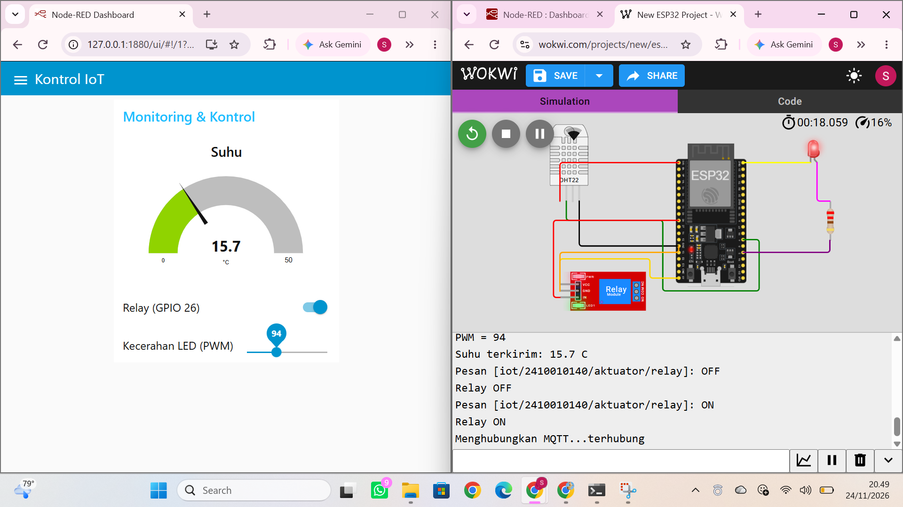

# Proyek Mini IoT - 2410010140

Proyek mini mata kuliah **Internet of Things (IoT)** menggunakan ESP32 yang terhubung ke dashboard Node-RED melalui protokol MQTT. Dashboard digunakan untuk memantau data dari perangkat serta mengontrol perangkat dari jarak jauh.

## Isi Repository

| File | Keterangan |
|---|---|
| `esp32_iot_mqtt.ino` | Program Arduino untuk ESP32 (koneksi WiFi, publish dan subscribe MQTT). |
| `flow_nodered_2410010140.json` | Flow Node-RED hasil export yang berisi logika dan konfigurasi dashboard. |
| `dashboard.png` | Screenshot tampilan dashboard Node-RED. |
| `kontrol_dashboard_ke_perangkat.mp4` | Video demonstrasi kontrol dari dashboard ke perangkat. |

## Arsitektur Sistem

```text
ESP32  <--MQTT-->  Broker MQTT  <--MQTT-->  Node-RED  -->  Dashboard
```

## Kebutuhan

- ESP32 dan Arduino IDE (dengan board ESP32 dan library `PubSubClient`).
- Node-RED dengan node `node-red-dashboard`.
- Koneksi WiFi.
- Akses ke broker MQTT.

## Cara Menjalankan

### 1. ESP32

- Buka file `esp32_iot_mqtt.ino` menggunakan Arduino IDE.
- Masukkan SSID dan password WiFi serta alamat broker MQTT pada bagian konfigurasi kode.
- Pilih board ESP32 yang sesuai.
- Hubungkan ESP32 ke komputer, kemudian upload program.

### 2. Node-RED

- Jalankan Node-RED.
- Buka menu **Import**.
- Pilih file `flow_nodered_2410010140.json`.
- Sesuaikan konfigurasi broker MQTT pada node MQTT.
- Klik **Deploy** untuk menjalankan flow.

### 3. Dashboard

- Buka browser.
- Akses alamat berikut:

```text
http://localhost:1880/ui
```

- Pantau data yang dikirim oleh ESP32.
- Gunakan kontrol yang tersedia pada dashboard untuk mengendalikan perangkat dari jarak jauh.

## Demo Proyek

**Tampilan Dashboard**



**Video Demonstrasi**

Lihat file `kontrol_dashboard_ke_perangkat.mp4` untuk melihat demonstrasi kontrol perangkat melalui dashboard Node-RED.
